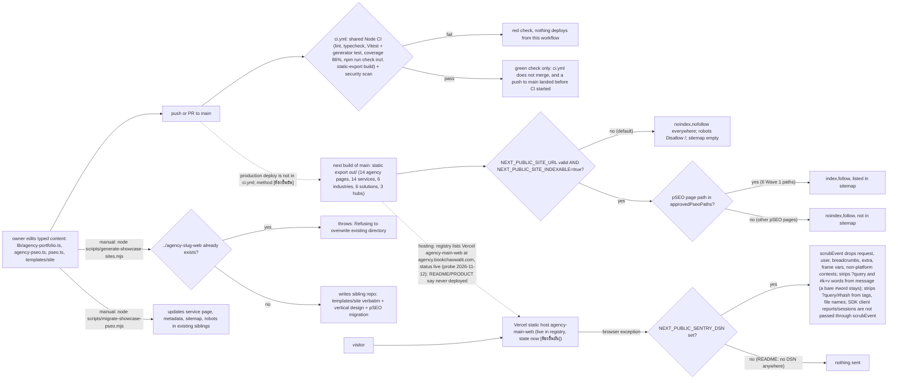
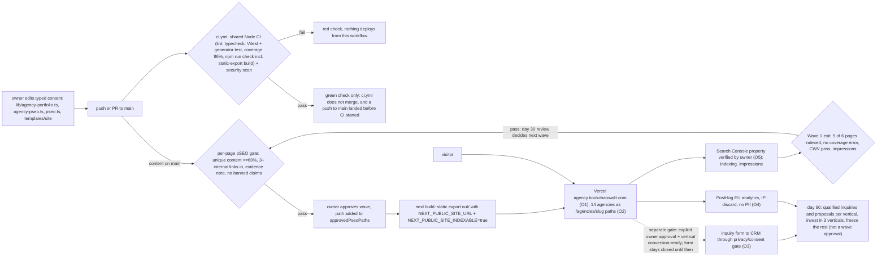

# 01 — Business process (As-Is / To-Be)

agency-main-web คือ baseline เนื้อหาและ generator ของเว็บ agency 14 vertical: เป็น static Next.js export ที่รวมหน้า `/agencies/<slug>`, service, industry และ solution (pSEO pilot) ในเว็บเดียว และเป็นสคริปต์ที่สร้าง/อัปเดต repo `agency-<slug>-web` ของแต่ละ vertical ผู้ใช้คือ owner เท่านั้น; ไม่มี form, API, ฐานข้อมูลหรือข้อมูลลูกค้า

Last reviewed: 2026-11-28 · commit `36af6bb`

## As-Is (จากโค้ดวันนี้)

Sources: `.github/workflows/ci.yml`, `scripts/generate-showcase-sites.mjs`, `scripts/migrate-showcase-pseo.mjs`, `lib/site-config.ts`, `lib/pseo-indexing.ts`, `app/sitemap.ts`, `app/robots.ts`, `lib/sentry.ts`, `README.md`, `PRODUCT.md`, `docs/pseo-pilot.md`, `docs/pseo-indexing-and-links-plan.md`

ข้อเท็จจริงจากโค้ดและเอกสาร:

- `approvedPseoPaths` ใน `lib/pseo-indexing.ts` มี 6 path (Wave 1, owner อนุมัติ 2026-11-07) เป็น fail-closed: pSEO page ใหม่เป็น noindex และไม่อยู่ใน sitemap จนกว่าจะเพิ่ม path ในรายการนั้น แม้เปิด global flag แล้ว
- `ci.yml` ไม่มี deploy step แต่รัน `npm run check` ซึ่งลงท้ายด้วย `npm run build` (static export) จึงมี build ใน CI เพื่อตรวจเท่านั้น; การ deploy ไม่อยู่ใน workflow. หลักฐานเรื่อง hosting ขัดกัน: `README.md` / `PRODUCT.md` บอกว่า repo นี้ไม่มี Vercel project และไม่ถูก deploy, `docs/pseo-indexing-and-links-plan.md` (O1, 2026-11-07) บอกว่า Vercel project `agency-main-web` deploy ด้วย CLI ที่ `agency.bookchaowalit.com` โดยยังไม่ตั้ง `NEXT_PUBLIC_SITE_INDEXABLE`, และทะเบียนกลาง (`repository-catalog/registries/vercel-projects.yaml`, `interface-coverage.yaml` ผลตรวจ production 2026-11-12) ระบุ project/URL เดียวกันและสถานะ `live`; วิธี deploy และสถานะล่าสุด/ค่า env [ต้องยืนยัน] จาก Vercel
- generator ไม่เขียนทับ directory เดิม (throw) และ sibling 14 repo ถูกปรับด้วยมือใน batch b-website ไม่ได้สร้างจาก generator (README)
- `scrubEvent` (`lib/sentry.ts`) ตัด request, user, breadcrumbs, extra, vars ใน stack frame และ context ที่ไม่ใช่ platform; ตัด ?query และคำ `#key=value` ออกจาก message ตามรูปแบบที่ตรวจจับได้ (คำ `#fragment` เดี่ยวที่ไม่มี `=` ยังอยู่) และตัด ?query/#hash จาก tag, ชื่อไฟล์ (ไม่ได้ตัดข้อความ error ส่วนอื่น); ครอบเฉพาะ error event: `sentryOptions()` ไม่ได้ปิด client report/session ของ Browser SDK ซึ่งไม่ผ่าน `beforeSend` [ต้องยืนยัน] จาก SDK ที่ติดตั้ง
- Sentry เชื่อมแต่ไม่ทำงานถ้าไม่มี DSN; README บอกว่าไม่มี DSN ที่ไหนเลย แต่ถ้า project บน Vercel มีจริงต้องตรวจ [ต้องยืนยัน]

## To-Be (docs/pseo-indexing-and-links-plan.md)

แผนเปิด index pSEO ทีละ wave พร้อม inquiry และ analytics หลังการตัดสินใจของ owner (O1–O5); เฉพาะสิ่งที่แผนเขียนไว้

Sources: `docs/pseo-indexing-and-links-plan.md`, `docs/pseo-pilot.md` §Measurement contract

## Gap

| ID | As-Is → To-Be | Status | Owner | Evidence |
|---|---|---|---|---|
| G1 | `approvedPseoPaths` fail-closed ต่อ path แทน flag ต่อ record → gate รายหน้าตามแผน | done | claude | `lib/pseo-indexing.ts`, `tests/pseo-indexing.test.ts`, `app/sitemap.ts` |
| G2 | Wave 1 อนุมัติ 6 path แต่ `NEXT_PUBLIC_SITE_INDEXABLE` ไม่ได้ตั้ง (ทั้งเว็บยัง noindex) → เปิด global flag ให้ Wave 1 ขึ้น index | decide | owner | `docs/pseo-indexing-and-links-plan.md` §Decisions log O1; สถานะ production [ต้องยืนยัน] |
| G3 | ไม่มี quality-gate checker ของ pSEO record → checker ตรวจ uniqueness, internal links, evidence ก่อนเพิ่ม path | todo | claude | `docs/pseo-indexing-and-links-plan.md` §Next actions |
| G4 | 14 vertical แยกเป็น 14 repo/Vercel project → รวมเป็น path `/agencies/<slug>/` ใต้ hub เดียว (ตัวเลือกที่แนะนำ O2) | decide | owner | `docs/pseo-indexing-and-links-plan.md` §Phase 0 O2 |
| G5 | ไม่มี form หรือ inquiry destination → ฟอร์มเข้า CRM ผ่าน privacy/consent gate | decide | owner | `docs/pseo-indexing-and-links-plan.md` O3; `PRODUCT.md` §What does not work |
| G6 | ไม่มี analytics identifier → PostHog EU (IP discard, ไม่เก็บ PII) ตาม measurement contract | decide | owner | `docs/pseo-indexing-and-links-plan.md` O4; `docs/pseo-pilot.md` §Measurement contract |
| G7 | ไม่มีหลักฐาน Search Console property → owner verify ด้วย DNS TXT ใน Cloudflare | todo | owner | `docs/pseo-indexing-and-links-plan.md` O5 |
| G8 | pSEO Wave 2 (10 หน้า) และ Wave 3 ยังไม่เริ่ม → ขยายเมื่อ Wave 1 indexed และมี impressions | blocked | claude | `docs/pseo-indexing-and-links-plan.md` §Phase 2 (รอ G2) |
| G9 | ไม่มีแผนงานเขียน backlink/case study ในโค้ด → ทำ Phase 3 (case study, README backlinks ใน public repos) | todo | claude | `docs/pseo-indexing-and-links-plan.md` §Phase 3, §Next actions |

## Open questions

- repo นี้ deploy ด้วยวิธีใดและ commit ไหนอยู่บน production: README/PRODUCT บอก "never deployed", แผน pSEO และทะเบียนกลางบอก Vercel project `agency-main-web` + `agency.bookchaowalit.com` สถานะ live (ดูจาก Vercel เท่านั้น แล้วแก้เอกสารที่ผิด)
- `NEXT_PUBLIC_SITE_URL` / `NEXT_PUBLIC_SITE_INDEXABLE` บน production ตั้งไว้ค่าอะไร
- `docs/pseo-indexing-and-links-plan.md` ยังเขียนสถานะ per-record `indexable` flag เป็นแผน ขณะที่โค้ดใช้ `approvedPseoPaths` แทน (G1)
